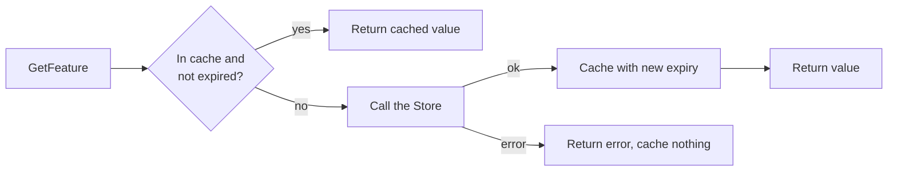

# Feature control cache

Feature flags are read on nearly every request but rarely change, so reading them from the database each time is wasted load. `Cache` wraps the database behind a `Store` interface and only calls it when needed.



## Usage

Implement `Store` against your database:

```go
type PostgresStore struct{ db *sql.DB }

func (s *PostgresStore) GetFeature(ctx context.Context, key string) (featurecontrol.Feature, error) {
	f := featurecontrol.Feature{Key: key}
	err := s.db.QueryRowContext(ctx, `SELECT enabled FROM features WHERE key = $1`, key).Scan(&f.Enabled)
	if errors.Is(err, sql.ErrNoRows) {
		return featurecontrol.Feature{}, featurecontrol.ErrNotFound
	}
	return f, err
}
```

Then wrap it, with the TTL taken from your config:

```go
cache, err := featurecontrol.NewCache(&PostgresStore{db: db}, 30*time.Second)
if err != nil {
	return err
}

enabled, err := cache.IsEnabled(ctx, "new-checkout")
```

`Cache` also implements `Store`, so callers can depend on the interface without knowing a cache is there.

## Choosing a TTL

The TTL is the longest a flag change can take to reach a running instance. A shorter TTL means faster rollouts and kill switches, and more database reads: at most one read per key, per instance, per TTL, apart from concurrent misses.

## Behaviour

- **Errors are not cached.** A database failure or `ErrNotFound` returns to the caller, and the next call tries the database again.
- **Expired values are not served.** If the database is down once a value expires, callers get the error rather than the stale value.

## Known limitations

- **Per-instance.** Each instance has its own cache, so instances can disagree for up to one TTL.
- **Unknown keys always reach the database.** Repeated lookups of a missing flag are not absorbed.
- **Concurrent misses are not merged.** When a popular key expires, every in-flight request calls the database until one of them fills the cache.
- **No manual invalidation.** A change takes effect only when the TTL runs out.
- **Expired entries stay in memory until reloaded.** This is fine for a small, fixed set of flags, but keys should not come from user input.

## Tests

```bash
cd go && go test ./featurecontrol/
```
